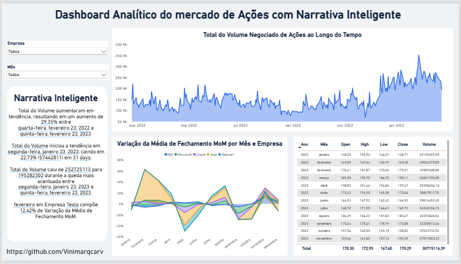

# 📈 Dashboard Analítico do Mercado de Ações com Power BI

## 🎯 Sobre o projeto

Mini-projeto desenvolvido durante minha formação na **Data Science Academy (DSA)**, no curso *Microsoft Power BI para Business Intelligence e Data Science*, com o objetivo de analisar o comportamento do mercado de ações por meio de dados públicos e visualizações interativas.

O projeto utiliza dados históricos de cinco empresas: **IBM, Microsoft, Oracle, Tesla e Walmart**, permitindo explorar o volume negociado, os valores de abertura, máxima, mínima e fechamento das ações ao longo do período analisado.

Além das análises tradicionais, foram explorados recursos de Time Intelligence e Narrativa Inteligente do Power BI, possibilitando acompanhar variações temporais e identificar tendências nos dados.

## 🛠️ Ferramentas e recursos utilizados

- Power BI Desktop;
- Time Intelligence;
- Narrativa Inteligente;
- Análise de séries temporais.

## 🏢 Empresas analisadas

O dashboard contempla dados de cinco empresas:

- IBM;
- Microsoft;
- Oracle;
- Tesla;
- Walmart.

Os dados utilizados são públicos e foram extraídos do portal [Nasdaq](https://www.nasdaq.com/).

## 📈 Indicadores e análises

O dashboard foi desenvolvido para responder às principais perguntas de negócio relacionadas ao comportamento das ações.

### 📊 Volume negociado ao longo do tempo

- Análise do volume total negociado das ações ao longo do período;
- Comparação do volume entre as cinco empresas;
- Possibilidade de analisar uma empresa individualmente ou combinar diferentes empresas.

### 💹 Indicadores do mercado de ações

Análise mensal dos principais indicadores de cotação:

- **Open:** valor de abertura das ações;
- **High:** maior valor atingido;
- **Low:** menor valor atingido;
- **Close:** valor de fechamento das ações;
- **Volume:** volume negociado.

Os indicadores são apresentados em formato de tabela, permitindo comparar os resultados entre empresas e períodos.

### 📉 Variação mensal do preço de fechamento (Close)

- Análise da variação percentual da média de fechamento das ações mês a mês;
- Comparação do comportamento das empresas ao longo do tempo;
- Identificação de períodos de valorização e desvalorização.

### 🧠 Narrativa Inteligente

Utilização do recurso de Narrativa Inteligente do Power BI para apresentar automaticamente informações relevantes sobre o comportamento dos dados, destacando tendências, variações e características do período analisado.

## 📊 Visualizações utilizadas

Foram utilizadas diferentes visualizações do Power BI para facilitar a interpretação dos dados:

- **Gráfico de área:** análise do volume total negociado ao longo do tempo;
- **Gráfico de linhas e áreas:** comparação da variação mensal da média de fechamento por empresa;
- **Tabela:** apresentação dos indicadores Open, High, Low, Close e Volume por ano e mês;
- **Narrativa Inteligente:** apresentação automática de informações e tendências identificadas nos dados;
- **Segmentações de dados:** filtros por empresa e mês.

## 🎛️ Interatividade

O dashboard permite explorar os dados sob diferentes perspectivas por meio de filtros interativos:

- **Empresa:** seleção individual ou combinada entre IBM, Microsoft, Oracle, Tesla e Walmart;
- **Mês:** seleção do período desejado para análise.

Esses filtros permitem comparar o comportamento das ações e explorar os indicadores de acordo com as empresas e os períodos selecionados.

## 🔎 Principais análises

O dashboard permite acompanhar a evolução do volume negociado das cinco empresas, comparar seus indicadores mensais de cotação e observar as variações da média de fechamento ao longo do tempo.

A utilização de Time Intelligence facilita a análise das mudanças entre períodos, enquanto a Narrativa Inteligente complementa as visualizações com informações automáticas sobre tendências e variações identificadas nos dados.

## 🖼️ Dashboard

## 🌐 Fonte dos dados

Os dados utilizados no projeto são públicos e foram extraídos do portal Nasdaq.

[https://www.nasdaq.com](https://www.nasdaq.com)

## 🎓 Contexto

Projeto desenvolvido como parte da formação em **Análise de Dados pela Data Science Academy (DSA)**, explorando recursos de análise temporal e interpretação de dados financeiros no Power BI.

## 👨‍💻 Autor

**Vinicius Marques**

Análise e Desenvolvimento de Sistemas | Power BI | Excel | SQL | Análise de Dados
